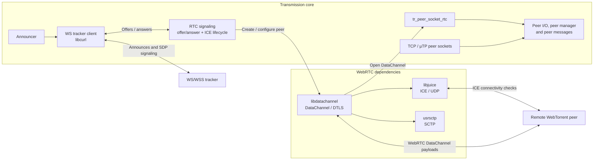
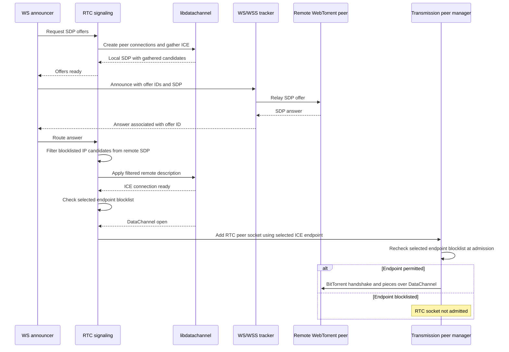
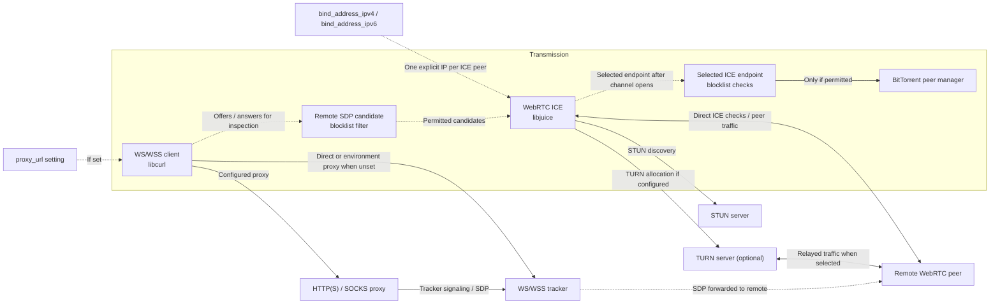

Transmission is fundamentally a BitTorrent client and communicates with other BitTorrent peers.
In addition to this Transmission supports network-based remote control, whereby an authorised user may control the Transmission core from the same or another machine via the [Transmission JSON RPC protocol](rpc-spec.md).
To make remote control easier from an arbitrary machine, Transmission core can also serve a JavaScript web application to any browser and which in turn makes JSON RPC calls back to the Transmission core.

The core components and methods of control are shown below:

From the above diagram it can be seen that a Transmission core may be controlled by the following:
 * _Local_ directly linked GUI (macOS, GTK+)
 * _Local_ or _remote_ Qt GUI
 * _Local_ or _remote_ command line utility
 * _Local_ or _remote_ Transmission web application running in a web browser

The multiple methods of controlling Transmission and the various native GUIs available result in several different Transmission products as shown in the figure below:

The products are:
 * Transmission desktop - macOS
 * Transmission desktop - Windows, Linux/Qt
 * Transmission desktop - Linux/GTK+
 * Transmission daemon (headless)
 * Transmission command line

The Transmission packages available on various distributions may include one or more of these components.
Note. Although the diagram shows "Transmission Desktop Qt" as being a Qt GUI with Transmission core, the Qt component may be packaged on its own as a purely remote tool.

## WebTorrent integration (optional)

The optional WebTorrent integration extends the existing Transmission core with WS/WSS tracker signaling and WebRTC DataChannel peers. It reuses the normal BitTorrent peer protocol and swarm management instead of introducing another torrent engine. This section describes the implementation in this branch; the diagrams use Mermaid so they remain editable and render in GitHub.

### Component view (C4-inspired)

The WS/WSS tracker path carries announces, SDP offers, and SDP answers. Torrent payload data instead flows over the WebRTC DataChannel into the existing peer I/O and swarm components. Conventional TCP and µTP peer sockets continue to use the same peer I/O layer.

### Outbound connection sequence

Outgoing peers use non-trickle ICE: the local offer is announced only after gathering is complete or the offer batch has been resolved. The incoming-offer path reverses the offer/answer roles. The tracker relays signaling, not piece data.

### Network paths and privacy boundaries

`proxy_url` controls libcurl's WS/WSS tracker connection, including its authentication and TLS behavior. It does **not** proxy ICE/UDP or SCTP/DTLS peer traffic. With no configured proxy, the WebSocket client follows the applicable libcurl environment proxy rules. The SDP passed through the tracker may include host and server-reflexive addresses. WebRTC connections can therefore disclose network addresses and use direct paths even when tracker signaling is proxied.

**Current policy boundaries:**

- `webtorrent_enabled` controls WebRTC and WS/WSS use at runtime (default `false`). `ENABLE_WEBTORRENT` controls compilation.
- ICE peers use `rtc::Configuration::bindAddress` when `bind_address_ipv4` or `bind_address_ipv6` is explicitly configured. When both are set, new ICE peers alternate between the configured IPv4 and IPv6 addresses because a single libjuice peer connection accepts only one bind address. Empty/wildcard addresses do not restrict ICE binding. Changes affect new ICE peers, not existing ones.
- Remote SDP candidates with parseable IP addresses found in Transmission's blocklist are now removed **before ICE negotiation**; if all advertised candidates are blocked, the session rejects the SDP. The selected remote ICE endpoint is checked again when ICE connects and before RTC peer admission. Unresolved candidates and peer-reflexive addresses not present in SDP cannot be prefiltered this way; a TURN-relayed endpoint may identify a relay rather than the underlying peer.
- `preferred_transports` currently lists only TCP and µTP. WebRTC is an independently enabled transport, and disabling TCP/µTP does not by itself disable WebRTC.
- Transmission has no general setting to force TCP/µTP/WebRTC peer connections through `proxy_url`; tracker proxy settings cannot guarantee proxy-only WebRTC communication.
- WebRTC DataChannels already use DTLS, so this branch uses a plaintext BitTorrent handshake inside the encrypted DataChannel rather than BitTorrent MSE. The interaction with `encryption = required` is an outstanding policy decision.

See [Configuration Files](Configuration-Files.md) for WebTorrent settings and [Building Transmission](Building-Transmission.md#optional-webtorrent-support) for compile-time dependencies.
